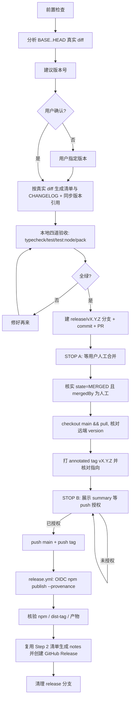

# Release：pi-provider-chain

## Overview

pi-provider-chain 的受控发版流程：**人工把三道闸门**（版本号确认 → PR 人工合并 → push 授权），其余步骤由 agent 自动完成并验证。

**核心原则：** 永不自动合并 PR、永不在未获当次授权时 push、永不在本地未核对 tag ↔ `package.json` 版本一致前打 tag。

**内容原则：** `CHANGELOG` 段落与 Release notes 一律由**代码真实 diff** 生成，不依赖 commit message、PR 描述、issue、既有 CHANGELOG 文本或上一版写法；diff 里找不到证据的内容一律不写。

### 本仓库的自动化事实（先读，别凭印象）

| 环节 | 事实 |
|---|---|
| 包 | npm 公开包 `pi-provider-chain`（unscoped） |
| 测试 CI | `.github/workflows/ci.yml`：push main + PR → `bun run typecheck`、`bun run test`；另有 Node 24 job 跑 `npm run test:node` |
| 发布 CI | `.github/workflows/release.yml`：push tag `v*` → 校验 tag↔version → 选 dist-tag → typecheck/test/test:node → `npm pack --dry-run` → `npm publish --ignore-scripts --provenance --access public --tag <dist-tag>` |
| 发布鉴权 | **OIDC Trusted Publishing**（`permissions.id-token: write`），仓库不再需要 `NPM_TOKEN` secret |
| GitHub Release | **workflow 不创建 Release**；notes 由本 skill 复用 Step 2 的 diff 清单（`docs/evidence/…/diff-inventory.md`）生成，再 `gh release create` |
| 内容真相源 | CHANGELOG 段落与 Release notes 都由 `git diff` 生成，并互相交叉校验；commit message / PR 描述 / 既有文案都不是生成源 |
| dist-tag | `package.json` 版本含 `-`（如 `0.2.0-beta.1`）→ 打 `next`；否则 `latest` |
| tag 命名 | `vX.Y.Z`，必须与 `package.json` 的 `version` 逐字符一致（workflow 已强制校验，本地仍要先核对） |
| 版本一致性双保险 | workflow 的 `Verify tag matches package version` 步骤：不一致直接失败，避免「tag 名 ≠ 实际发布版本」写进永久历史 |

> workflow 与本节描述必须保持同步：改动 `release.yml` 后回来更新这张表。

## When to Use

- 用户说「发版 / 发布新版本 / release / publish / bump version / 打 tag」
- 准备首次把本包发布到 npm（见文末「首次发布特例」）

## 前置检查（每次发版都先跑）

```bash
git status --short                  # 必须为空
git branch --show-current           # 必须 main
gh auth status                      # 必须已登录（repo 权限）
git describe --tags --abbrev=0      # 有 tag：上次版本；报 "No names found"：首次发版
npm view pi-provider-chain version  # 有值：包已存在（OIDC 可用）；404：尚未发布 → 见「首次发布特例」
date +%F                            # CHANGELOG 用当天日期 YYYY-MM-DD
```

### OIDC 发布的前置条件（Trusted Publishing）

`release.yml` 用 OIDC 发布，**不需要 token，但要求 npm 侧已存在该包并已配置 Trusted Publisher**：

| npm 包设置项 | 必须值 |
|---|---|
| Provider | GitHub Actions |
| Organization or user | `yansongda` |
| Repository | `pi-provider-chain` |
| Workflow filename | `release.yml`（只写文件名，含 `.yml`，大小写敏感） |
| Allowed actions | 必须允许 **`npm publish`**（默认只放开 stage publish，会发布失败） |

- 无法用命令查询该配置（npm 无公开 API）→ 由用户在 npm 包设置页核对；agent 只读检查 `npm view pi-provider-chain version` 是否存在。
- 另外要求：npm CLI ≥ 11.5.1、Node ≥ 22.14（workflow 用 Node 24，满足）；`package.json` 的 `repository.url` 必须与 GitHub 仓库一致（本仓库已一致）。
- **新配置的 Trusted Publisher 必须在 2 天内完成一次成功发布**，否则配置过期，只能删除重建。
- 兜底方案（若暂不配 OIDC）：给 workflow 加回 `env: NODE_AUTH_TOKEN: ${{ secrets.NPM_TOKEN }}` 并在仓库配置 secret；本 skill 默认走 OIDC，改用 token 后需要在 README 与本文同步说明。

## 三道闸门（不可越）

| 闸门 | 谁决定 | agent 行为 |
|---|---|---|
| 版本号 | 用户确认或指定 | 给建议 + 理由，等待确认 |
| PR 合并 | 用户人工在平台合并 | 只创建 PR，明确停止 |
| `git push`（分支/tag） | 用户当次明确说「push / 推送 / 执行」 | 展示将执行的命令，等待授权 |

push 授权同时覆盖其后置动作：标签核验、npm 发布核验、以及复用 Step 2 的 diff 清单生成 notes 并创建 GitHub Release（**创建前把 notes 内容展示给用户过目**）。

「完成」「处理一下」「惯例上要 push」**都不构成授权**；上一轮会话的授权不延续到本轮。

## Release Flow



## Step-by-Step

### Step 1：分析改动并建议版本

**以真实 diff 为准，不以 commit message 为准。**

```bash
# 无 tag（首次发版）时 BASE 取根提交
BASE=$(git describe --tags --abbrev=0 2>/dev/null || git rev-list --max-parents=0 HEAD)
git diff "$BASE"..HEAD --stat
git diff "$BASE"..HEAD -- src/ extensions/ tests/ examples/ package.json README.md CHANGELOG.md
```

**语义化版本规则：**

- **破坏性变更**（配置字段/文件名、命令名、公开导出、行为契约变化）：1.0.0 之前记 **minor**（`0.X.0`），并在 CHANGELOG「变更」里显式写 `BREAKING`；1.0.0 之后记 major
- **新功能**：minor
- **修 bug / 文档 / 内部重构**：patch
- **预发布**：`X.Y.Z-beta.N`，beta 期间任何改动递增 N（CI 会自动打 `next` dist-tag，`latest` 保持不动）
- **只有文档或示例改动**：仍发 patch（不攒着）
- **自上次 tag 以来零 diff**：先问用户是否仍要发版，不擅自继续

**向用户呈现：**

```
自 vX.Y.Z（或首次发布）以来的改动：
- 代码（src/ extensions/）：<要点清单>
- 配置/契约变化：<有/无，是否 BREAKING>
- 测试/CI：<要点>
- 文档/示例：<要点>

建议版本：vX.Y.Z（理由：…）
确认？或直接给版本号。
```

### Step 2：按真实 diff 生成改动清单 → 撰写 CHANGELOG → 同步版本引用

**唯一依据是代码真实 diff。** commit message、PR 描述、issue、既有 CHANGELOG 文本都不是生成源——它们可能与代码不一致（commit message 会漏、会夸张）。某条改动在 diff 里找不到证据，就不写进 CHANGELOG。

#### 2.1 生成改动清单（逐模块过一遍 diff）

```bash
BASE=$(git describe --tags --abbrev=0 2>/dev/null || git rev-list --max-parents=0 HEAD)
git diff "$BASE"..HEAD --stat                                 # 全貌
git diff "$BASE"..HEAD -- src/ extensions/                    # 代码：功能与行为变化
git diff "$BASE"..HEAD -- tests/                              # 测试：行为契约的旁证
git diff "$BASE"..HEAD -- examples/ README.md package.json    # 对外契约与用法
```

按模块角色逐块精读（不同文件影响小节归属与版本档位）：

| 看哪里 | 能看出什么 | 主要落到 |
|---|---|---|
| `src/constants.ts` | 用户可见文案、默认 pattern、错误前缀 | 功能 / 变更 |
| `src/config.ts` | 配置字段、文件路径、校验规则、默认值（**BREAKING 高发区**） | 变更 |
| `src/command.ts` | `/chain` 子命令与参数 | 功能 / 变更 |
| `extensions/provider-chain.ts` | 虚拟模型注册、事件钩子、命令与渲染器装配 | 功能 |
| `src/route-policy.ts`、`src/router.ts` | 路由决策、档位推进、恢复判定、上限钳制 | 功能 / 修复 |
| `src/state.ts`、`src/degrade.ts` | 状态读写/合并/清理、降级判定与时间解析 | 修复 / 工程 |
| `src/ui.ts`、`src/transcript.ts` | notify / 页脚 / 转录条目等面向用户的呈现 | 功能 / 变更 |
| `tests/` | 新增或改写的断言 = 行为契约变化的旁证（区分「纯重构」与「行为变化」的关键） | 旁证 |
| `examples/`、`README.md` | 示例配置与文档口径变化 | 变更 / 工程 |

**双向核对（做完再动笔）：**

- **覆盖率**：diff 中每处用户可见变化（字段、命令、导出、文案、默认值、行为分支的增删改）都要落到清单条目；漏项即返工
- **可追溯**：每条清单项都指得出证据（文件 + 符号/hunk）；写不出证据的条目删掉
- **定性**：区分「行为变化」与「纯改名/移动/格式化」；纯重构只能进「工程」，不许包装成「功能」，也不许算作「修复」
- **BREAKING 必查**：配置字段/文件名、命令名、公开导出、默认值、用户可见前缀（如 `[chain]`）、文件路径 → 命中即按 minor 记，并在「变更」里写 `BREAKING` + 迁移方式

**清单落盘**（gitignored 目录，便于复核与回溯）：

```bash
mkdir -p docs/evidence/$(date +%F)-release-v$NEW
# 逐模块结论写入 docs/evidence/$(date +%F)-release-v$NEW/diff-inventory.md
git check-ignore -v docs/evidence/     # 确认该目录确实被忽略，不会混进发版 PR
```

这份清单是 Step 10 生成 Release notes 的**唯一来源**：发布后不再重跑 diff，直接复用。

#### 2.2 用清单撰写 CHANGELOG 段落

**CHANGELOG 格式（沿用本仓库 0.1.0 的中文小节）：**

```markdown
## X.Y.Z - YYYY-MM-DD

<一句话概括本版主题>

### 功能
- 新增 …（`src/xxx.ts`）

### 变更
- BREAKING: …（`src/config.ts`，说明迁移方式）

### 修复
- 修复 …

### 工程
- 仅内部可见的重构/测试/CI 改动
```

写作约束：

- 条目里保留标识符原文：文件路径、字段名（`` `chain[]` ``）、命令（`` `/chain status` ``）；每条都能对应到清单里的一行证据
- 必须自洽可读：标题行 → 主题句 → 小节 → 条目，不依赖 PR 上下文（Step 10 的 notes 与它同源生成并交叉校验）
- 不写「详见 PR」这类无信息条目；不写内部工单号/未公开链接；不搬 commit message
- diff 里没有的能力，一个字都不许出现

#### 2.3 同步全部版本引用（四处，缺一不可）

```bash
NEW=0.2.0                       # 用确认后的版本替换
sed -i '' "s/\"version\": \".*\"/\"version\": \"$NEW\"/" package.json   # macOS
grep -n '"version"' package.json
git grep -n "<旧版本>" -- .     # 兜底：找出所有残留引用
```

1. `package.json` → `version`（**决定 npm 发布版本与 CI 的 tag 校验**）
2. `CHANGELOG.md` → 新增 `## <NEW> - <YYYY-MM-DD>` 段落（按 2.1 / 2.2 生成）
3. `README.md` → 「安装」小节的 `pi install npm:pi-provider-chain@<NEW>`
4. `git grep` 兜底结果里其余需要跟版本走的位置（历史设计文档 `docs/*.md` 属历史记录，**不改**）

### Step 3：本地四道验收（CI 等价，全绿才继续）

```bash
bun install --frozen-lockfile   # 确认 lockfile 与 package.json 一致
bun run typecheck
bun run test
bun run test:node               # Node ≥ 22.18 直跑 TS（CI 用 Node 24 守这条承诺）
bun run pack                    # bun pm pack --dry-run：检查 files 白名单
```

`bun run pack` 的产物清单必须与 `package.json` 的 `files` 一致：应包含 `extensions/provider-chain.ts`（`pi.extensions` 入口）、`src/`、`examples/`、README、CHANGELOG、LICENSE；不应包含 `tests/`、`docs/`。

**任何一道失败都不许继续**，修好后从 Step 3 重跑。

### Step 4：建 PR

```bash
git checkout -b release/vX.Y.Z
git add package.json CHANGELOG.md README.md
git commit -m "chore(release): vX.Y.Z"     # 仓库风格：conventional 前缀 + 中文正文
git push origin release/vX.Y.Z            # 需要用户当次 push 授权
gh pr create --base main --title "chore(release): vX.Y.Z" --body "## 发版 vX.Y.Z

<CHANGELOG 摘要>

- 本地验收：typecheck / test / test:node / pack 全绿
- tag \`vX.Y.Z\` 推送后由 release.yml 以 OIDC 发布到 npm（--provenance）
- GitHub Release 由 release skill 复用本次改动的 diff 清单生成 notes 后创建（不用 --generate-notes）"
```

**STOP A。** 对用户说：

```
PR #N 已创建：<链接>
等待你人工审核合并；合并后告诉我，我再打 tag。
```

**此时不要做**：合并 PR、`gh pr merge`、开启 auto-merge、打 tag、push tag。

> 注：`docs/implementation/` 与 `docs/evidence/` 已在 `.gitignore` 中，发版 PR 不应包含它们。

### Step 5：合并后核实并同步本地

```bash
gh pr view <N> --json state,mergedAt,mergedBy,mergeCommit
# 必须 state=MERGED 且 mergedBy.login 为人工账号（非 bot）

git checkout main
git pull origin main
grep -n '"version"' package.json          # 必须等于 X.Y.Z
git log --oneline -1                      # 必须是合并提交
```

### Step 6：打 tag（annotated）并核对指向

```bash
git tag -a vX.Y.Z -m "Release vX.Y.Z"
git show vX.Y.Z --stat | head -20         # tag 所在提交必须含本次版本改动
git describe --tags --abbrev=0            # 应输出 vX.Y.Z
```

**一致性铁律：** tag 名 = `v` + `package.json` 的 `version`，逐字符相同。workflow 会强制校验（不一致就 fail，不发布），但那时 tag 已经推上去了，收尾更麻烦——本地先核对。

### Step 7：展示 Release Summary，等 push 授权

```
## Release Summary: vX.Y.Z

### 改动
<CHANGELOG 内容>

### 本地状态
- tag：vX.Y.Z（annotated，指向 <commit>）
- 分支：main（= origin/main + 本次版本改动）
- 待执行：git push origin main && git push origin vX.Y.Z

### push 后会自动/随后发生
1. release.yml：校验 tag↔version → typecheck + test + test:node → npm pack --dry-run
2. npm publish --provenance（OIDC，dist-tag: latest|next）
3. agent 核验 npm 与 dist-tag 后，复用 Step 2 的 diff 清单写出 notes、与 CHANGELOG 段落交叉校验，再创建 GitHub Release（创建前会先把 notes 给你看）

等待你明确授权 push。
```

**STOP B。** 只有用户明确说「push / 推送 / 执行」才继续。

### Step 8：push（获授权后）

```bash
git push origin main
git push origin vX.Y.Z        # 若本地只有一个新 tag，git push origin main --tags 等价
```

避免无差别 `--tags`：会把本地其它陈旧 tag 一起推上去。

### Step 9：发布后核验（必做，别只看 CI 绿灯）

```bash
gh run list --workflow=release.yml --limit 1
gh run watch <run-id> --exit-status          # 失败时：gh run view <run-id> --log-failed

npm view pi-provider-chain version                       # 必须等于 X.Y.Z
npm view pi-provider-chain dist-tags --json               # latest（或预发布时的 next）应指向 X.Y.Z
npm view pi-provider-chain@X.Y.Z dist.tarball dist.integrity
npm view pi-provider-chain@X.Y.Z --json | grep -A5 attestations   # OIDC 发布应带 provenance
```

**补充产物核验（推荐）：**

```bash
cd /tmp && npm pack pi-provider-chain@X.Y.Z
tar -tzf pi-provider-chain-X.Y.Z.tgz | sort | head -40
# 必须含 package/extensions/provider-chain.ts、package/src/*；不应含 tests/、docs/
```

### Step 10：用 Step 2 的 diff 清单生成 Release notes 并创建 GitHub Release

workflow 不再创建 Release，这一步由 agent 完成。**不再重跑 diff**：Step 2.1 的改动清单（来自代码真实 diff，且已做过覆盖率与可追溯核对）就是 notes 的来源。

```bash
TAG=vX.Y.Z; VER=${TAG#v}
INV=$(ls -t docs/evidence/*-release-v$VER/diff-inventory.md 2>/dev/null | head -1)
if [ -z "$INV" ]; then
  echo "缺少 Step 2 的清单 → 回 Step 2.1 补做（清单是 notes 的前置产物，也是唯一来源）"
else
  NOTES="$(dirname "$INV")/release-notes.md"
fi

# 可选 10 秒体检（不是重看 diff）：确认待发布提交集合没有超出 Step 2 分析过的范围
PREV=$(git describe --tags --abbrev=0 "$TAG^" 2>/dev/null || git rev-list --max-parents=0 "$TAG")
git log --oneline "$PREV".."$TAG"
```

1. 按清单里已有的小节归属写出 notes：标题行 `## X.Y.Z - <YYYY-MM-DD>` + 主题句 + 小节（功能/变更/修复/工程）；**不额外加「生成说明」等段落**
2. 若 `git log` 里出现清单未覆盖的提交（如发布 PR 合并后又有提交）→ 只补看这批提交的 diff 与条目，其余照旧复用清单
3. **交叉校验**：与仓库里的 CHANGELOG 段落逐行比对（两者同源，正常应完全一致；用于兜住 Step 2 之后的改动或写漏）
   ```bash
   diff -B <(awk -v h="## $VER - " 'index($0,h)==1 {p=1} p && /^## / && index($0,h)!=1 {exit} p {print}' CHANGELOG.md) "$NOTES"
   ```
   - 无差异 → 同源一致，可以创建 Release
   - 有差异 → 回 Step 2.1 的清单裁决（notes 以清单 + 真实 diff 为准）；若差异是「CHANGELOG 漏写/写错」，不要篡改已发布历史：更正放进下一版 CHANGELOG（或单开文档 PR），并在 summary 里告知用户
   - `-B` 忽略「仅空行」差异（分段空行不算内容差异，否则会持续误报），内容行的增删改仍会检出
   - notes 与 CHANGELOG 的标题行必须逐字一致（含日期 `## X.Y.Z - YYYY-MM-DD`），否则会一直报差异
4. 把 notes 内容展示给用户过目（它会成为公开内容），再创建：
   ```bash
   # 稳定版
   gh release create "$TAG" --title "$TAG" --notes-file "$NOTES" --verify-tag --latest
   # 预发布版
   gh release create "$TAG" --title "$TAG" --notes-file "$NOTES" --verify-tag --prerelease

   gh release view "$TAG"                        # 核对 notes 渲染与 tag
   ```

- **禁止** `--generate-notes`：它汇总 commit/PR 文本，不是代码 diff
- `--verify-tag`：tag 不存在则报错，防止建出指向错误提交的 Release

### Step 11：清理 release 分支

```bash
git push origin --delete release/vX.Y.Z      # 需 push 授权
git branch -d release/vX.Y.Z
git remote prune origin
```

## 异常与回滚

| 情况 | 处理 |
|---|---|
| tag 打错，尚未 push | `git tag -d vX.Y.Z`，修正后重打 |
| tag 已 push，publish 还没跑 | `git push origin --delete vX.Y.Z`（授权），改完从 Step 4 起重走 |
| `Verify tag matches package version` 失败 | 本地版本与 tag 不一致 → 删 tag，改 `package.json` 走 PR 后重打 |
| publish 报 `Unable to authenticate` / 401 / 404（OIDC） | 逐项核对 npm 包设置的 Trusted Publisher：仓库/用户/`release.yml` 文件名大小写、是否允许 `npm publish`、`package.json` 的 `repository.url` 是否与仓库一致；修好后 `gh run rerun <run-id>` |
| Trusted Publisher 配置过期（超 2 天未成功发布） | 删除并重建配置，然后重新触发一次发布（新的 tag 或失败的 run） |
| publish 403（版本已存在，npm 不可覆盖） | 该版本已在 npm 上 → 发下一个 patch 版本，不要重跑同一 tag |
| publish 成功但没建 GitHub Release | 由本 skill 补 Step 10（生成 notes + `gh release create`）；**不要 rerun workflow**——重跑会二次 publish 同版本 → 403 |
| notes 与 CHANGELOG 段落对不上 | 回 Step 2.1 的 diff 清单裁决（两者同源）：notes 以清单为准；CHANGELOG 的更正走下一版或单独文档 PR，不篡改已发布历史 |
| tag 范围里混进了清单未覆盖的提交 | `git log PREV..TAG` 发现后，只补看这批提交的 diff 与条目，其余复用清单；并在 summary 里指出 CHANGELOG 缺口 |
| Step 2 的 diff 清单没落盘就合并了 PR | 从 CHANGELOG 段落的条目反查 diff 补做清单（仍以 diff 为准），或补跑 Step 2.1，再生成 notes |
| 预发布把 dist-tag 打成 `next`，`latest` 未变 | 预期行为；需要切换时用 `npm dist-tag` 手动调整（要 npm 侧 dist-tag 权限） |
| 发布后才发现 CHANGELOG 写错 | 不改已发布内容；在下一版 CHANGELOG 里更正（如需可 `gh release edit vX.Y.Z --notes-file …` 修公开 notes） |
| 已发布版本有严重问题 | `npm deprecate pi-provider-chain@X.Y.Z "原因"`（用户执行），随后尽快发 patch |

## 首次发布特例（`npm view pi-provider-chain version` 返回 404 时适用）

**关键约束：OIDC Trusted Publishing 要求 npm 上包已存在**（包设置页无法访问，首次 CI 发布必然 404/ENEEDAUTH）→ **首发必须在本地手动完成一次**。

1. 用户本机手动首发（**凭据由用户亲自输入，agent 不接触**）：
   ```bash
   npm login && npm whoami
   npm publish --access public     # 仓库已有 prepublishOnly：test + typecheck
   ```
2. 首发成功后立刻在 npm 包设置 → Trusted Publisher 填：GitHub Actions / `yansongda` / `pi-provider-chain` / `release.yml`，并允许 `npm publish`。
3. **随后 2 天内**让下一版走 `tag → CI` 流程（Step 1→Step 11），既验证发布链路，也避免 Trusted Publisher 配置过期。
4. 首发版本（如 `0.1.0`）建议**不打 git tag、不建 GitHub Release**：npm 是分发渠道，首个 GitHub Release 从下一版（`0.1.1`/`0.2.0`）由 CI + skill 建立，历史更干净。
   如确需给首发版本建 Release：复用 Step 2 的 diff 清单生成 notes（首发没有前序 tag 不影响这一步，清单已覆盖全部改动），再 `gh release create v0.1.0 --title v0.1.0 --notes-file <notes>`（它会在远端创建 tag；若因此触发一次 publish 失败的 run，属预期噪声——该版本已由本地发布，CI 再发必然 403）。
5. 首发也要做 Step 9 的核验，并确认 README「安装」小节的 `pi install npm:pi-provider-chain@X.Y.Z` 与实际发布版本一致。

## Anti-Patterns & Rationalizations

| 借口 | 事实 |
|---|---|
| 「用户说发版，就等于授权 push」 | 发版 ≠ push。tag push 是本次唯一不可逆动作，必须当次授权 |
| 「PR 上 CI 已经绿了，可以自动合并」 | 永不自动合并（AGENTS.md 红线），等用户合并后告知 |
| 「CHANGELOG 直接抄 commit message 更快」 | commit message 会漏、会夸张；唯一依据是 `git diff` 的真实改动 |
| 「Release notes 直接复制 CHANGELOG 段落就好」 | 可以——前提是这段 CHANGELOG 确实出自 Step 2 的 diff 清单（做过覆盖率/可追溯核对）；没做清单就贴旧文本 = 依赖既有文案 |
| 「Step 10 再跑一遍 diff 更保险」 | 同一次改动不必看两遍：复用 Step 2 清单；只在 `git log PREV..TAG` 出现新提交时补看那几笔 |
| 「照着上一版 CHANGELOG 的句式改改就行」 | 句式可以复用，内容不行：条目必须来自本次 diff 清单（含覆盖率与可追溯核对） |
| 「Release notes 用 `--generate-notes` 省事」 | 它汇总 commit/PR 文本，不是代码 diff；本仓库要求 notes 与 diff 同源 |
| 「本地测过了，CI 那三道可以跳」 | 四道本地验收全绿才继续；tag 后 CI 还会再跑一遍 |
| 「版本号小改一下无所谓，先打 tag」 | workflow 会直接 fail 在 tag↔version 校验；tag 已推上去还要收尾 |
| 「OIDC 配不配都一样」 | 没配 Trusted Publisher 时 CI 发布必失败；包不存在时首发也只能手动 |
| 「publish 失败重跑整个 workflow 就好」 | 若该版本其实已发布成功，重跑会 403；先查 npm 再决定 |
| 「GitHub Release 建不建无所谓」 | 它是本流程的收尾交付物；漏了要按 Step 10 补，且不能靠 rerun workflow |

## Red Flags — 立即停下

- 未获当次授权就 `git push`（分支或 tag）
- 任何形式的 PR 自动合并
- tag 名与 `package.json` 版本不一致仍打/推 tag
- Release notes 用 `--generate-notes` 或 commit message 代替「复用 Step 2 的 diff 清单 + 与 CHANGELOG 交叉校验」
- CHANGELOG 条目拿不出 diff 证据（凭记忆、凭 PR 标题、凭上一版改句式写）
- 本地四道验收没跑或没全绿就创建 PR
- 把 token、`_authToken`、密码写进文件/日志/命令输出（本流程不需要任何 token）
- 没核验 npm 与 GitHub Release 就宣布发版完成

## Quick Reference

| 步骤 | 命令要点 | 授权 |
|---|---|---|
| 前置检查 | `git status --short`、`npm view pi-provider-chain version`、`git describe --tags` | 无需 |
| 版本建议 | `git diff $(git describe --tags --abbrev=0)..HEAD` | 需用户确认版本 |
| diff→清单 | 逐模块 `git diff BASE..HEAD -- <路径>` + 双向核对，清单落 `docs/evidence/`（Step 10 复用） | 无需 |
| 版本同步 | 按清单写 `CHANGELOG.md` 段落；`package.json` / `README.md` / `git grep <旧版本>` | 无需 |
| 验收 | `bun run typecheck && bun run test && bun run test:node && bun run pack` | 无需 |
| PR | `chore(release): vX.Y.Z` → `gh pr create --base main` | push 分支需授权；合并永远人工 |
| tag | 合并后 `git tag -a vX.Y.Z` + `git show` 核对 | 无需（本地） |
| push | `git push origin main && git push origin vX.Y.Z` | **需当次明确授权** |
| 核验 | `gh run watch`、`npm view … dist-tags/attestations`、`npm pack` 查产物 | 无需 |
| Release | 复用 Step 2 清单写 notes → 与 CHANGELOG 交叉比对 → `gh release create --notes-file … --verify-tag` | 含在 push 授权内，notes 先给用户看 |
| 清理 | `git push origin --delete release/vX.Y.Z` | 需授权 |

## 相关文件（真相来源）

- `.github/workflows/release.yml`（tag 触发的 OIDC 发布定义：本文「自动化事实」表的来源）
- `.github/workflows/ci.yml`（PR/main 的测试定义）
- `package.json`（`version`、`files`、`pi.extensions`、`prepublishOnly`）
- `CHANGELOG.md`（版本段落与 Release notes 同源：都由真实 diff 生成并互相交叉校验；条目格式取样见 0.1.0）
- `docs/evidence/`（gitignored：Step 2 的改动清单与 Step 10 的 notes 草稿落盘处，不入库）
- `README.md`：不记录发版步骤（「发布」小节已移除），发版口径以本 skill 与 `release.yml` 为准。

<!-- 本 skill 位于仓库内 .agents/skills/release/，pi 从仓库根递归发现；编辑后用 /reload 生效。 -->
